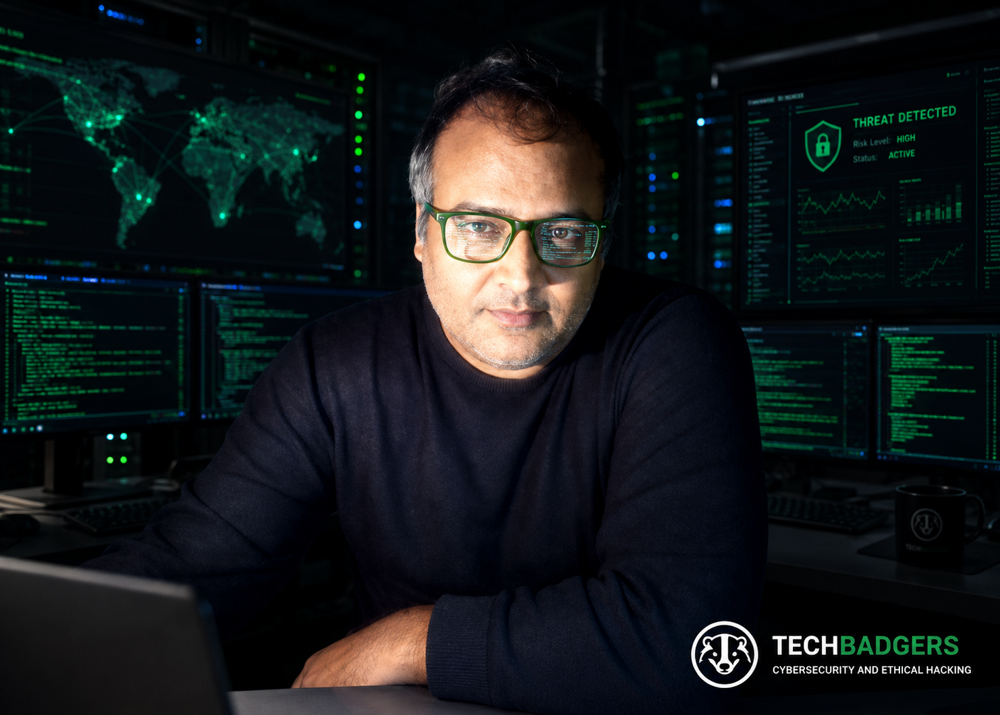

  

# Cyber-Badger

### Digging Vulnerabilities Relentlessly, Helping Secure Foundations Bottom Up!

**Cybersecurity | GRC | DFIR | SIEM | OSINT lab architect | Risk Management | Risk Audits | VAPT & NPT | Security Assessments | IR**

We at Cyber-Badger, a cybersecurity wing of Tech Badgers, professionally build practical capabilities across GRC, Security Assessments, Data Forensics & Incident Response, Threat Hunting, Vulnerabilities Assessment basis OWASP Top 10 list, Open-Source Intelligence lab setups, VAPT, NPT and Establishing Security Controls.

Our Badgers at Cyber-Badger wing of Tech Badgers, approach technical investigation with a risk-oriented mindset: understanding vulnerabilities, assessing their potential impact, identifying control gaps and developing practical recommendations to strengthen security with proper reporting and SOP handouts to provide self-reliant easy to follow steps play book for our clients self serve demeanor.

We believe effective cybersecurity starts with understanding risks at the foundation and building stronger security always begins from the bottom up.

---

## About Us

- 🎯 **Area Focus:** Governance, Risk & Compliance (GRC), Information Security and Risk Management.
- 🔐 **Projects beyond Focus:** Vulnerability Assessment, Web Application Security, Network Threat Hunting, Digital Forensics and Incident Response.
- 📋 **GRC Interests:** Risk Assessment, Security Controls, Compliance Readiness, Audit Evidence and Risk Treatment.
- 🧪 **Practical Development:** Hands-on security assessments, investigation exercises and technical security labs.
- 🌎 **Location:** New Jersey, USA and Ontario, Canada.
- 👥 **TechBadger's-CyberBadgers:** Ganesh K., Vishal M., Anurag N., Vivek S.
- 🏅 **Professional Certifications:** ITIL v3 Foundation, CompTIA A+, CompTIA Security+ and CISA

## Security Tools & Technologies

**Web Application Security**
- Burp Suite
- Vega

**Penetration Testing & Exploitation Labs**
- Metasploit Framework

**SIEM & Security Monitoring**
- Wazuh
- Splunk

**Network Security & Analysis**
- Wireshark
- PCAP Analysis

**Security Assessment & Investigation**
- Vulnerability Assessment
- Authentication Security Testing
- Network Threat Hunting
- Digital Forensics Fundamentals
- Incident Response & Security Documentation

## Practical Security Lab Architecture

Architected, Approvals Attained, Installed, Configured and Trained Cyber-Badgers to work hands-on with Burp Suite, Vega, Metasploit Framework, Wazuh and Splunk in a Kali Linux virtualized environment using VMware as part of a project.

Applied these tools through practical security exercises and real-world project scenarios.

## Governance, Risk & Compliance Focus

Developing professional capabilities in:

- Information Security Governance
- Risk Identification and Assessment
- Security Controls and Control Evaluation
- Risk Treatment and Mitigation
- Compliance and Audit Readiness
- Security Documentation and Evidence Management
- Incident Response and Security Reporting

## Featured Cybersecurity Projects

### 1. Web Application Authentication Security Assessment

Authorized web application penetration-testing engagement involving authentication security and brute-force testing.

**Tools:** Burp Suite, Vega

### 2. PCAP File Forensics & Malware Intelligence Investigation

Network traffic examination and investigation of potentially malicious activity using packet capture analysis.

**Focus Areas:** PCAP Analysis, Network Forensics, Malware Intelligence and Network Indicators.

### 3. Network Threat Hunting Using Wireshark

Practical network threat-hunting exercise involving traffic analysis, investigation filters and identification of suspicious network indicators.

**Tools:** Wireshark

### 4. Personal System Security & Risk Assessment

Assessment of system assets, potential threats, vulnerabilities and associated risks, with practical security recommendations.

**Focus Areas:** Asset Identification, Threat Analysis, Vulnerability Assessment, Risk Evaluation and Risk Mitigation.

### 5. Isolated OSINT Lab — Infrastructure & Security Architecture

**Status:** In Progress

Developing an isolated virtualized environment on an HP ProDesk for controlled OSINT research, investigative workflows and security experimentation.

**Key Focus Areas:**
- Virtualized lab architecture.
- Network isolation and segmentation.
- Operational security.
- Controlled investigative workflows.
- Secure handling of research data.

### 6. Cyberbullying Incident — Incident Response & Malware Containment SOP

Developed a practical Standard Operating Procedure (SOP) following a cyberbullying-related incident involving suspected malware and compromised communication accounts.

**Scope of the SOP included:**
- Isolation guidelines for office servers and individual Windows workstations.
- Isolation and security precautions for Android mobile devices.
- Procedures to reduce the risk of malware spreading between affected systems.
- Safe communication guidelines while affected devices were being assessed.
- Account security and access-review recommendations.
- Practical containment, documentation and recovery guidance.

**Key Areas:** Incident Response, Malware Containment, Endpoint Isolation, Security Procedures and Operational Risk Reduction.

*Client-sensitive engagements and supporting evidence are excluded from public repositories unless publication is authorized.*

---

## Professional & Portfolio Links

- **Company:** [Tech Badgers](https://techbadgers.com/)
- **Company Portfolio:** [Tech Badgers GitHub Pages](https://cyber-badger.github.io/TechBadgers/)
- **Personal Projects:** [Vivek-Sagar GitHub Repository](https://github.com/Cyber-Badger/Vivek-Sagar)

---

### Digging deeper. Understanding risk. Strengthening security.
